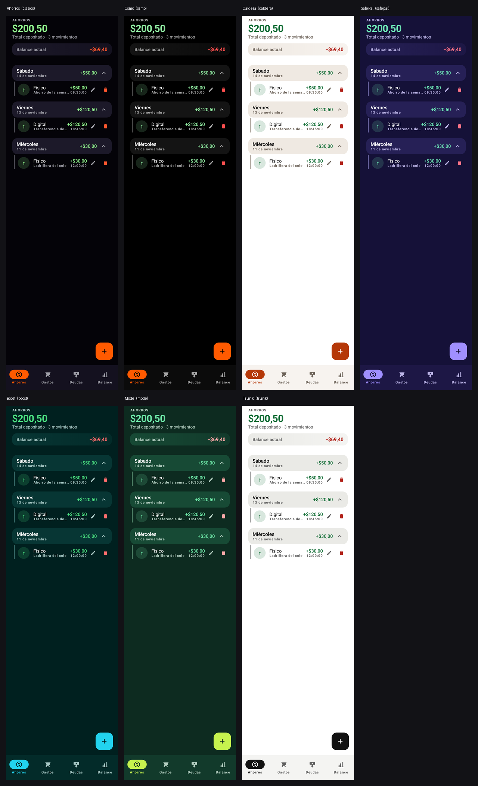
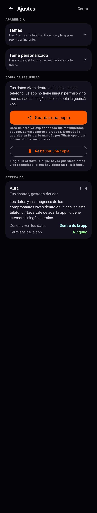
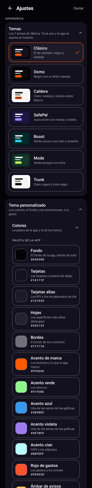
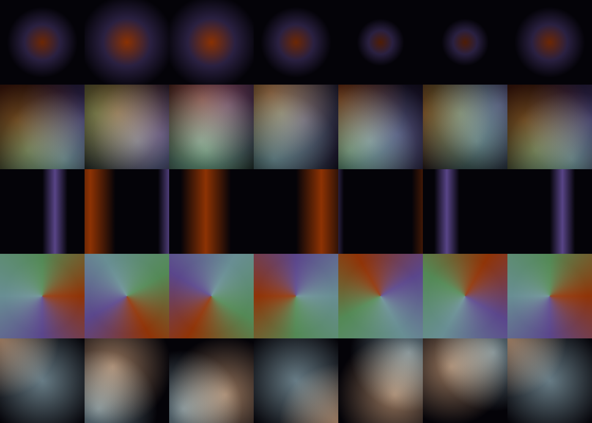

# Aura

**App de ahorros, gastos y deudas.** Android nativo, sin internet y sin un solo permiso.

Aura sirve para llevar las cuentas del día a día: cuánto ahorrado tenés, en qué se te va la
plata, y —lo que más pesa en la escuela— a quién se le tiene que cobrar.



## Descargar

Hay dos versiones de la misma app. La diferencia es **una sola lista de 24 nombres**:

| Versión | Para quién | Archivo |
|---|---|---|
| **Aura v1.17** | Cualquiera | [`apk/Aura-v1.17.apk`](apk/Aura-v1.17.apk) |
| **Aura 11G v1.17** | Los del 11G: trae la lista del salón ya escrita | [`apk/Aura-v1.17-11G.apk`](apk/Aura-v1.17-11G.apk) |

> **Instalá `Aura-v1.17.apk` si no sos del 11G.**
> La del 11G es EXACTAMENTE la misma app con la lista del salón escrita de antemano
> (para no tener que teclear los 24 nombres). Además instala con otro paquete, así que
> las dos conviven en el mismo teléfono sin pisarse.

Para instalar: copiá el `.apk` al teléfono y abrilo. Android va a pedir permiso para
instalar apps de fuentes desconocidas: es normal, es el aviso de siempre.

Si preferís bajarlo de GitHub, los mismos `.apk` están en la [release v1.17](https://github.com/CesarSamudio/aura/releases/tag/v1.17).

## Qué hace

- **Ahorros y gastos**: cuánto entró, cuánto salió, y el balance del día.
- **Deudas**: armás la deuda, decidís cuántos la pagan, y le vas marcando a cada
  quién cuánto puso. Con **monto especial** para cuando alguien paga otra cosa.
  Y si **no sabés cuántos van a pagar**, dejás el campo vacío y la cuota se calcula
  con la gente que vayas añadiendo.
- **Pruebas por persona**: adjuntás el screenshot de la transferencia (solo con YAPI)
  y queda guardado con la deuda.
- **Listas de gente**: creás tus propias listas (un curso, un equipo) y quedan
  guardadas para las próximas deudas: abrís, marcás lo que falta y listo.
- **7 temas**: negro y naranja, y además Osmo, Caldera, SafePal, Boost, Mode y Trunk
  (claros y oscuros). Se cambian en **Ajustes → Apariencia** y se aplican al instante.
- **Colores a tu gusto**: además de los temas, se puede cambiar **cada color por
  separado** (la paleta de la app y la de los textos) con un selector de color que
  te dice, en vivo, si ese color se lee o no.
- **Fondo con tu foto**: se elige una imagen del teléfono (la app la reescala para
  que se vea bien y no pese tanto) y se le ajusta la opacidad y el difuminado (de
  verdad, con kernel gaussiano: se ve como el de una lente, no a píxeles).
- **Fondo animado**: degradados que se mueven (aureola, aurora, barrido, cónico o
  malla), con su opacidad, velocidad e intensidad. El movimiento es **un bucle
  continuo**: el fondo nunca da un salto cuando el ciclo termina, y la velocidad se
  aplica al instante (se nota en la vista previa, sin salir de Ajustes).
- **Preferencias** (Ajustes → Preferencias): dos interruptores que cambian **cómo se
  cuentan** los números, y se aplican al instante:
  - *Los pagos de las deudas van a los ahorros*: cuando marcás a alguien como pagado,
    el dinero también se suma a tus ahorros (y si después borrás ese pago, el depósito
    se borra con él).
  - *Combinar ahorros con gastos*: al gastar, los ahorros bajan: lo que tenés es lo
    que metiste menos lo que gastaste.
- **Deuda individual**: un tipo de deuda para **una sola persona**. No hay lista de
  gente ni cuota que repartir (el nombre de la persona es el de la deuda), pero todo
  lo demás sigue igual: los montos, los pagos y el comprobante.
- **Animaciones a tu medida**: las gráficas, los números y la interfaz se pueden
  apagar, acelerar o frenar, y cada cosa tiene su estilo. Apretando y soltando
  una opción te explica qué hace.
- **Copia de seguridad**: genera un `.zip` con todo y lo guardás donde quieras
  (Drive, WhatsApp, correo). Sin nube y sin cuentas.

## Privacidad

- **Cero permisos.** Ni internet, ni almacenamiento, ni cámara, ni ubicación.
- Todo vive dentro de la app, en el teléfono. Nada sale de acá.
- El `.zip` de la copia lo compartís vos, cuando querés.

> Ojo: si desinstalás la app, Android borra su carpeta y se pierden los datos.
> Por eso está la copia de seguridad.

## Para compilar

Requisitos: JDK 21, Android SDK (compileSdk 35) y Gradle 8.11.

```bash
# Las dos versiones (la general y la del 11G)
./gradlew assembleGeneralRelease assembleG11Release

# Los tests
./gradlew testGeneralReleaseUnitTest testG11ReleaseUnitTest
```

Las dos versiones se hacen con **product flavors** (`general` y `g11`). Lo único que
cambia entre ellas está en:

```
app/src/general/java/com/cesar/ahorros/data/ListaSalon.kt   -> null
app/src/g11/java/com/cesar/ahorros/data/ListaSalon.kt       -> la lista del 11G
```

### La clave de firma

**No está en el repositorio** (a propósito: con esa clave cualquiera podría firmar una
versión de la app). Para compilar una versión firmada poné el `.jks` en
`app/keystore/ahorros.jks` y las contraseñas en `local.properties`:

```properties
aura.storePassword=...
aura.keyAlias=...
aura.keyPassword=...
```

Sin la clave, el build compila igual pero el APK sale **sin firmar** (no se puede instalar).

## Cómo está hecho

- **Kotlin + Jetpack Compose** (Material 3), sin librerías de terceros.
- **MVVM** con `StateFlow`; los datos se guardan en **JSON plano** dentro de la carpeta
  de la app (`movimientos.json`, `deudas.json`, `listas.json`, `ajustes.json`).
- **Sin base de datos**: para este volumen es instantáneo y no pesa nada en el APK.
- **237 tests** en verde (270 con las capturas), entre ellos uno que mide el
  **contraste de color de los 7 temas contra WCAG 2.2 AA** y otro que mide el
  contraste de los colores que personaliza el usuario.- Las capturas de pantalla de los tests se generan en el PC con **Robolectric**
  (gráficos nativos), sin emulador.
- **El fondo animado está comprobado fotograma a fotograma**: un test dibuja un ciclo
  completo del degradado y mide que el final sea **idéntico** al principio (que es lo
  que evita el salto al terminar), y otro comprueba que la velocidad se aplica al
  instante sin salir de la pantalla.

## Las capturas

| | |
|---|---|
|  |  |
| **Ajustes → Apariencia**: los temas de fábrica | **Colores**: cada color por separado, con su hexadecimal |

Y el fondo animado, fotograma a fotograma (una fila por forma; el primer fotograma y
el último son el mismo punto del ciclo, así que el bucle no da ningún salto):



## Licencia

MIT.
